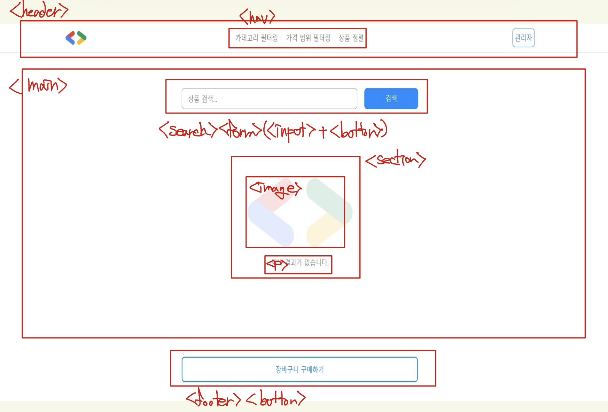

# Mission 01 - HTML

## 1. HTML의 Element와 Attribute는 무엇인가요?

- Element: 시작 태그부터 콘텐츠, 종료 태그까지를 합친 하나의 덩어리
- Attribute: 요소에 추가 정보를 주는 것으로, 시작 태그 안에 이름="값" 형태로 작성한다.

## 2. div와 Semantic Tag의 차이는 무엇인가요?

div는 아무 의미가 없는 범용 컨테이너라서, 영역의 역할을 알려면 class 이름을 봐야 한다. 반면 header, nav, main, footer 같은 시맨틱 태그는 태그 이름 자체가 영역의 역할을 나타낸다.

## 3. `<article>` vs `<section>` 두 태그의 차이점은 무엇인가요?

`<article>`은 독립적으로 완결된 콘텐츠를 나타낸다. 페이지에서 떼어내 다른 곳에 배치해도 그 자체로 의미가 통하는 경우에 쓴다.

`<section>`은 관련된 내용을 주제별로 묶은 구획이다. 문서 전체의 일부라서 단독으로는 의미가 완결되지 않으며, 보통 그 주제를 나타내는 제목과 함께 쓴다.

## 추가 학습 정리

### 기타 HTML 태그

`<a>` : 링크

`<ul>` / `<ol>` / `<li>` : 목록 / 순서 있는 목록 / 목록 항목

`` : 이미지

`<form>` : 입력 폼

`<input>` : 입력창

`<label>` : 입력창 이름표

`<strong>` : 중요한 내용 강조

### 시맨틱 태그 구조 분해



```html
<header>
  <a href="/"></a>
  <nav>
    <ul>
      <li><a href="#">카테고리 필터링</a></li>
      <li><a href="#">가격 범위 필터링</a></li>
      <li><a href="#">상품 정렬</a></li>
    </ul>
  </nav>
  <button>관리자</button>
</header>

<main>
  <search>
    <form>
      <input type="search" placeholder="상품 검색..." />
      <button type="submit">검색</button>
    </form>
  </search>

  <section>
    
    <p>검색 결과가 없습니다.</p>
  </section>
</main>

<footer>
  <button>장바구니 구매하기</button>
</footer>
```